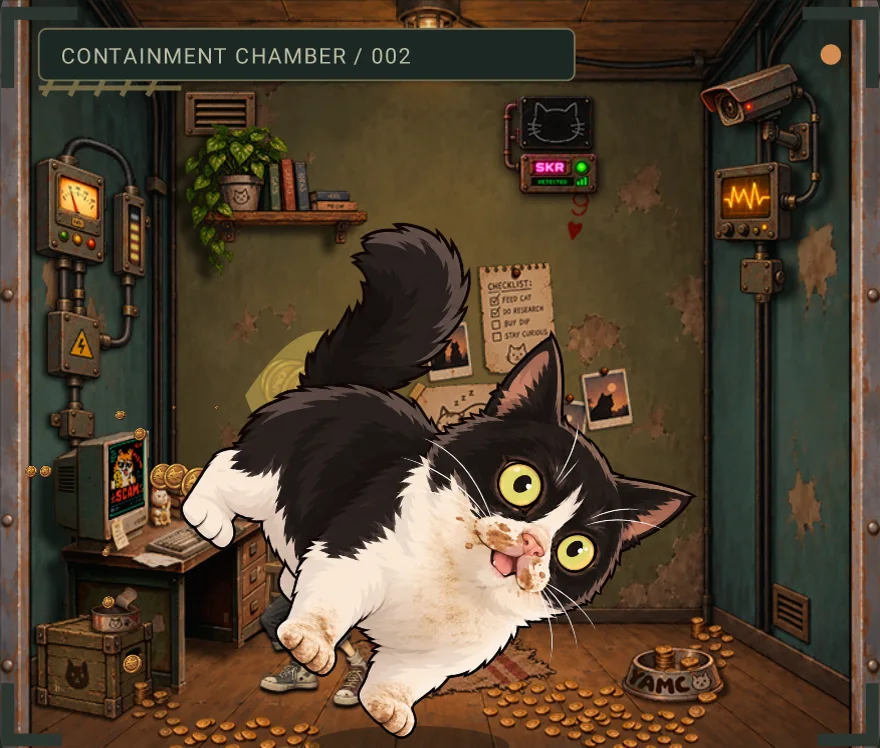

# Yet Another Market Cat 💩

**Lock CATSHIT. The cat suffers. The chain settles.**

A working **Android / React Native** game with **Solana Mobile Wallet Adapter**, real wallet approvals and independently verifiable **devnet** rewards. Built for Clock In — Solana Mobile Hackathon.

[Website · English](https://yetanothermarket.cat/?lang=en) · [Català](https://yetanothermarket.cat/?lang=ca) · [Android APK 0.13.6](https://yetanothermarket.cat/downloads/yet-another-cat-0.13.6.apk) · [Verify The Shit](https://yetanothermarket.cat/cycles) · [CI](https://github.com/LumenBrowny/yet-another-market-cat/actions)



## How it works

Get 2,000 test CATSHIT from the in-app faucet once per wallet, lock at least 1,000, and earn Poop Points according to your tier and elapsed finalized chain time. Each nonempty hourly Shit Cycle distributes 100,000 existing CATSHIT proportionally. Claim your allocation through your wallet. You need devnet SOL for fees and account rent.

**The phone does not mine. The cat suffers independently.** PP continues with the app closed; animation and phone CPU do not create rewards. The mobile Cat Shit Engine provides 2.5D motion, touch, sound and BONK haptics, tested on a physical Android phone.

## Architecture and verification

Android → MWA → Solana custody and claim receipts. Finalized history → deterministic accounting → canonical manifest and Merkle root → independent replay verification → on-chain publication → wallet claim.

The separate verifier recalculates PP and allocations without using the accounting database. The configured publisher fails closed if independent verification cannot pass. Public reports are timestamped cached checks, not a new replay per browser visit.

**Publicly verifiable, not fully trustless.** The publisher is centralized. The program is upgradeable and unaudited, and there is no on-chain challenge/fraud-proof mechanism. Fixed supply prevents minting new tokens; it does not prove fair allocation. See [architecture](docs/architecture.md), [protocol](docs/protocol.md) and [verification](docs/verification.md).

## Canonical devnet

Program: `BfNiASrYNqmARu2TQ1eBa1PJ6KgVHTNn44ATk5rJe6zW`

Mint: `A8viyp5aA6Pw59HzzVWPd5tkgS2gup2cZyd7TPmyAupZ`

100 million fixed CATSHIT; mint and freeze authorities disabled. Initial reserves: 1 million faucet / 99 million rewards. One-hour cycles; empty cycles emit zero. Test tokens have no promised monetary value. [Deployment and APK checksum](docs/devnet-deployment.md).

## Build and tests

Node.js 24 and .NET 10:

```sh
npm ci
npm test
npm run typecheck
npm run lint
dotnet test server/YetAnotherCat.Tests -m:1
dotnet publish server/YetAnotherCat.Api -c Release -o dist/api -m:1
cargo fmt --all -- --check
cargo check --workspace
```

[Build and run](docs/build-and-run.md) covers Android SDK/JDK, signed releases, Rust/SBF tests, local deployment and backend configuration. No private files are needed to build; publishing to a chain requires your own signing credentials. [Mobile behavior](docs/mobile.md).

## Source map

| Directory             | Purpose                                                      |
| --------------------- | ------------------------------------------------------------ |
| `app/`                | Native Android client and current media                      |
| `programs/`           | Anchor program: custody, settlement and claims               |
| `packages/`           | Shared protocol helpers and Cat Shit Engine                  |
| `server/`             | .NET accounting/indexing/publisher and public web/API        |
| `scripts/`            | Independent replay, build, fixtures and asset regeneration   |
| `protocol/`, `tests/` | Deterministic vectors and substantive tests                  |
| `infra/`              | Container deployment templates and generic maintenance       |
| `docs/`               | Current architecture, protocol and reproduction instructions |

`docs/` is reserved for maintained product, protocol and build documentation. Working plans, submission drafts and acceptance reports belong in the Git-ignored `local-notes/` directory. Build artifacts remain in ignored `artifacts/`; secrets remain outside documentation.

## SKR / Nine Lives

The detector reads the connected wallet’s real **mainnet SKR** balance. Find **9♥** and tap the neon cat **nine times in four seconds** to enter or leave Nine Lives. Music and dancing cats are cosmetic: no SKR transaction and no CATSHIT reward advantage. CATSHIT gameplay stays on devnet.

## License and media

No open-source license has been selected for the original code. Do not assume a blanket license for bundled media. Third-party dependency licenses remain applicable. The source uses a CC0-based Nine Lives loop; [media and licensing](docs/mobile.md#media-and-licensing) distinguishes it from the older hosted APK and Git history.
