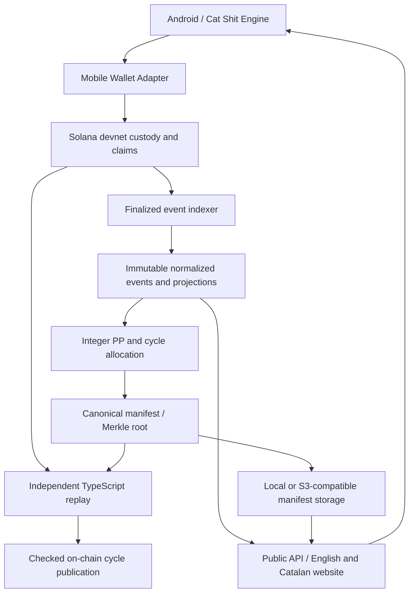

# Architecture

Yet Another Market Cat is a native React Native Android app, a Solana Anchor program, a .NET accounting/publisher service, an independent TypeScript verifier, and a bilingual public website.

The primary RPC supplies operational state and indexing. Verify RPC supplies independent replay. Only finalized events and block times advance accounting. Integer PP projections can be rebuilt from retained normalized events; full independent verification instead reads finalized chain history.

PostgreSQL is used by the public deployment; SQLite is supported for local work. EF migrations are retained. Canonical immutable manifests live in S3-compatible storage (MinIO in the current deployment). Caddy serves HTTPS/static assets/downloads and proxies the API. The public site, API and storage share one VPS, so availability is not decentralized.

The Android renderer is not a WebView wrapper. Its fixed-step pseudo-physics, sound and haptics visualize tier state without affecting rewards. Wallet approval remains in the MWA wallet app. Mainnet SKR lookup only gates a cosmetic room.

## Trust boundary

Publicly verifiable, not fully trustless. The publisher is centralized and the program remains upgradeable/unaudited. Independent replay can detect incorrect allocations but there is no on-chain challenge or fraud-proof mechanism. A malicious publisher could bypass its configured off-chain verification gate. On-chain proofs validate committed leaves; they do not recalculate historical PP.

Fixed supply, finite vault and permanent ClaimReceipt prevent new minting and duplicate claims under the current program. They do not establish fair historical allocation. Complete RPC history, finality and manifest availability remain dependencies. [Verification](verification.md) and [protocol](protocol.md).
